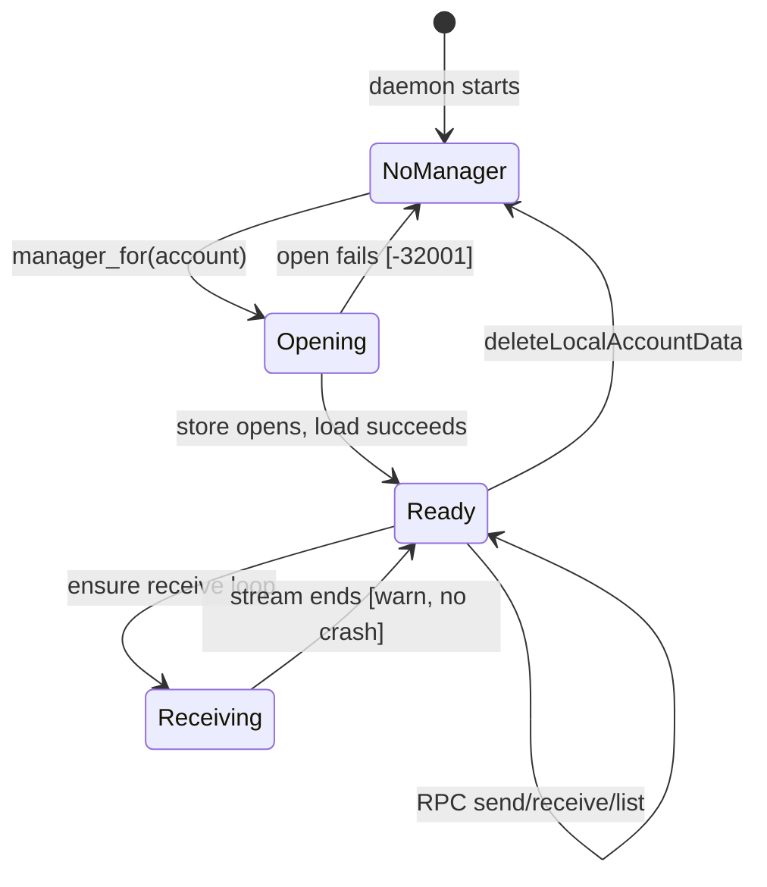
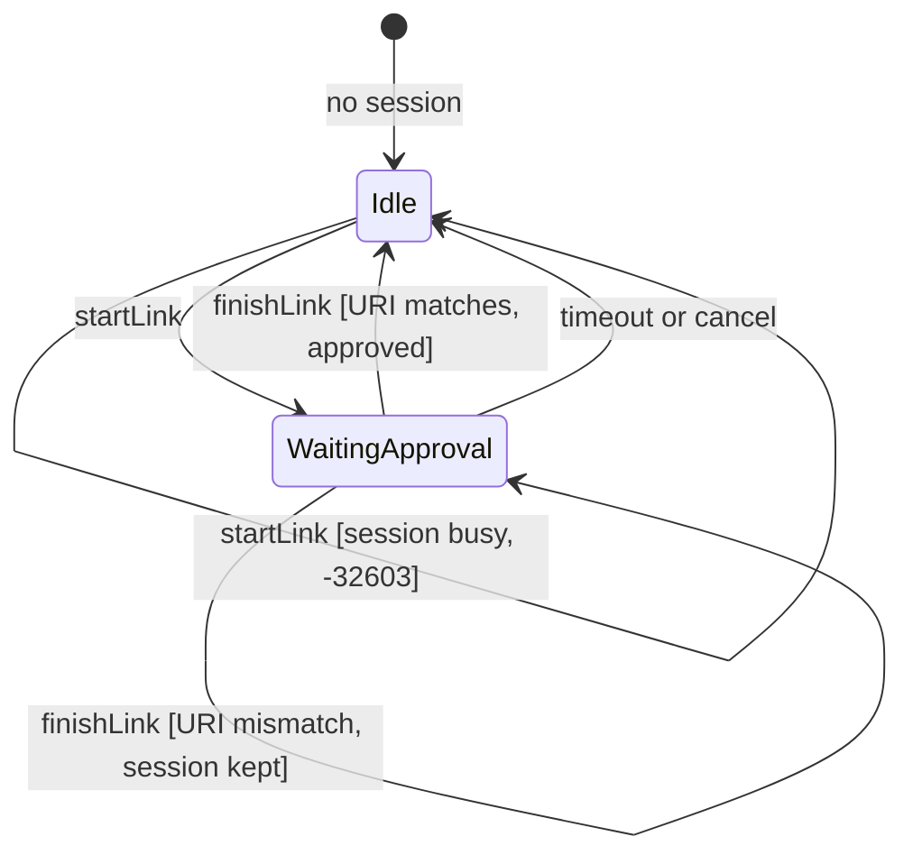
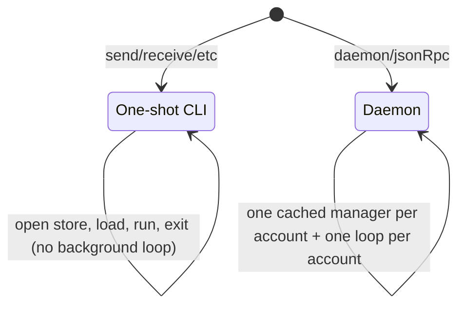

# Architecture review (Rust signal-cli port)

This document explains the design of the refactor batches. It is an
explanation, not a reference. For command parity, read
`docs/command-status.adoc`.

References below name files and symbols, never line numbers. Line
numbers rot. Every count states the command that regenerates it.

## Grounding

This section records the tree as it stood before the first batch.

One-shot CLI commands opened `+E164.db` through
`utils::open_sqlite_store`. `main.rs` special-cased `Daemon` and
`JsonRpc` as accountless. `commands/mod.rs` matched every `Command`
variant and silenced unused flags with `_:`. `rpc/handler.rs`
re-matched every JSON-RPC method with `handle_*` forwarders.
`rpc/context.rs` cached one `Manager` per account. `rpc/server.rs`
and `rpc/context.rs` each owned a copy of the receive-loop to
notification code. `utils.rs` kept trust policy in a `thread_local!`.
`output.rs` defined `Render`; `errors.rs` mapped `SignalError` to
JSON-RPC codes. `compat.rs` mirrored every CLI flag with warnings.
`commands/runtime.rs` kept `load_registered_and_receive` as a
pass-through for compatibility.

## Tech debt inventory

1. Hand-synced command lists. `Command::name()`,
   `Command::requires_account()`, the dispatch match in
   `commands/mod.rs`, the method table in `rpc/handler.rs`, the
   warnings in `compat.rs`, and the accountless list in
   `rpc/context.rs` all list the same commands. A test in `cli.rs`
   greps its own source to guard the drift.
2. Triple execution layers. Each behavior had `run_*` to open the
   store, `core_*` for manager logic, and `handle_*` for RPC param
   parsing. Example: the send path across `messaging.rs` and
   `handler.rs`.
3. Generic leakage. `Manager<S: Store>` appeared in every `core_*`
   signature. Only `SqliteStore` was ever constructed.
4. Thread-local trust. `push_store_identity` set thread-local state.
   HTTP workers run on different Tokio threads than the CLI entry
   thread.
5. Duplicated receive loops. `server.rs` and `context.rs` both built
   `receive` notifications from the same envelope code.
6. Split link ownership. CLI link and RPC `startLink`/`finishLink`
   both managed temp `link_temp_*.db` files through
   `new_link_temp_db_name`, `finalize_link_database`, and
   `remove_link_db_files`.
7. Error mapping in three places. `render_command_error`,
   `rpc_result_to_response`, and the daemon account-error branch
   each mapped errors to JSON-RPC codes.
8. Ignored-flag interface. `commands/mod.rs` silenced some 30 flags
   with `_:`, and `compat.rs` warned about the same flags.

## Sketch A: deep dispatcher (chosen base)

One `AppContext` carries config, trust, and attachment policy.
One `AccountStore` owns the `.db` files and the manager cache.
One `DomainCommand` enum comes out of both CLI and RPC boundaries.
One `dispatch` function replaces `run_*`, `core_*`, and `handle_*`.

```rust
// Contract sketch. The shipped code differs where noted below.
pub struct AccountId(String); // validated E.164, branded
pub struct GroupKey([u8; 32]); // parsed once at the boundary

pub struct AppContext {
    pub config_dir: std::path::PathBuf,
    pub trust: crate::cli::TrustMode,
    pub attachment_dir: Option<std::path::PathBuf>,
}

pub struct AccountStore { /* config, trust, cached managers */ }

impl AccountStore {
    pub async fn manager_for(&self, id: &AccountId) -> anyhow::Result<ManagerHandle>;
    pub async fn list_accounts(&self) -> anyhow::Result<Vec<AccountId>>;
}

pub enum DomainCommand {
    Send(SendArgs),
    Receive { max_messages: Option<usize> },
    ListGroups { detailed: bool, filter: Vec<GroupKey> },
    // ... one variant per behavior, no ignored fields
}
```

CLI and RPC adapters parse into `DomainCommand` and call `dispatch`.
`Manager` is concretized to `SqliteStore`. No generic `Manager<S,
...>` signatures remain. Run `grep -rn 'Manager<S' src/` to check
that. Trust travels as `ctx.trust`, not thread-local state.

Shipped differences: `AccountStore` holds trust itself instead of
taking `AppContext` per call. Recipient stayed as presage
`ServiceId` with a `resolve_aci_bytes` helper. A separate
`Recipient` enum never shipped.

## Sketch B: ports-and-adapters (rejected as full shape, mined for parts)

`domain` holds pure `AccountId`, `GroupKey`, and `SendArgs`.
`store` owns `.db` renames and deletes with no manager knowledge.
`signal` hides `Manager` behind a gateway trait with a fake for tests.
`shell/cli` and `shell/rpc` stay thin adapters. One receive
supervisor owns all background loops and the broadcast channel.

```rust
pub trait PresageGateway: Send {
    fn send_text(&mut self, to: Vec<Recipient>, body: String) -> impl Future<Output = anyhow::Result<u64>> + Send;
}

pub struct ReceiveSupervisor { /* one task per AccountId, single notification builder */ }
impl ReceiveSupervisor {
    pub async fn ensure_running(&self, id: &AccountId) -> anyhow::Result<()>;
    pub async fn stop(&self, id: &AccountId);
}
```

B isolates presage better. B loses on interface depth. Four new
public interfaces cost more reader load than the isolation buys at
this repo size.

## Red-flag screen

- Shallow module. A hides dispatch and policy behind one interface.
  B spreads them across four traits. A wins.
- Information leakage. Both hide `Manager<S>` and wire types. A
  adopts the `AccountId` and `GroupKey` branding from B.
- Temporal decomposition. Both group by ownership
  (`AccountStore`), not by load, validate, and save stages.
- Pass-through. Both delete the `runtime.rs` forwarder and the
  `handle_*` forwarders.
- Split ownership. Both give `.db` files, the manager cache, and
  receive loops to one owner each.
- Two ways. Both unify CLI and RPC onto `DomainCommand`.
- Importable internals. Both remove the `pub(crate) use account::*`
  glob. Adapters import only `dispatch` and `DomainCommand`.
- Hand-synced list. Both derive dispatch, the accountless set, and
  compat warnings from one table.

## Synthesis decision

Sketch A is the base. Sketch B contributed branded
`AccountId`/`GroupKey` types, the explicit trust parameter, and the
single receive supervisor (folded into `AccountStore` with
`src/rpc/notify.rs` as a sibling). The full B shape lost: four
interfaces cost more than the isolation buys here.

## Tradeoffs accepted

- Concretizing to `SqliteStore` deletes every `S: Store` generic.
- One bigger `DomainCommand` enum deletes five hand-synced lists.
- Moving attachment-dir and env fallback to the CLI boundary keeps
  core logic pure.

## Alternatives considered

- Full ports-and-adapters (Sketch B). Deeper presage isolation,
  but four public interfaces and deeper call chains. It lost on
  interface depth.
- Incremental cleanup (keep `run_*` and `core_*`, dedupe only
  loops). Smallest diff, but it preserves triple layers and
  thread-local trust. It lost because it fixes instances, not the
  root split.

## Open questions and risks

- Does any caller rely on `Manager` genericity beyond `SqliteStore`?
  Resolved: no. Only `SqliteStore` is constructed anywhere. All
  signatures now take `RegisteredManager`.
- Is the `link_temp_*` rename safe on all filesystems, or should
  linking write directly to the final path? Open.
  `finalize_link_database` and `remove_link_db_files` are the single
  owner now, and both CLI and RPC use them.
- Should `subscribeReceive` gain real subscription tracking, or stay
  a documented no-op? Open. It stays a documented no-op.
  `core_subscribe_receive` returns `0`.

## Implementation log

Verified with `cargo fmt --check`, `cargo clippy -- -D warnings`,
and `cargo test` (33 passed).

- This batch concretized generics. Every `core_*`, `handle_*`,
  `resolve_recipient`, and `build_receive_envelope` takes
  `RegisteredManager` from `src/app.rs`.
- This batch deleted the pass-through. `load_registered_and_receive`
  is gone. Every call site uses `load_registered`. Run
  `grep -rn load_registered_and_receive src/` to check that.
- This batch unified receive loops. `src/rpc/notify.rs` owns
  `build_receive_notification` and `spawn_receive_loop`. `server.rs`
  and `context.rs` call them.
- This batch made trust explicit on the daemon path.
  `DaemonContext::manager_for` and `rpc_start_link` pass
  `OnNewIdentity` as a value. The CLI one-shot path keeps
  `push_store_identity` on its single `LocalSet` thread. The
  multi-threaded HTTP path no longer depends on thread-local state.
- This batch unified error mapping.
  `errors::json_rpc_code_for` is the single mapping. `output.rs` and
  `handler.rs` call it.
- This batch introduced domain types. `AccountId` and `GroupKey` live
  in `src/domain.rs` and parse once at boundaries. `AppContext` and
  `AccountStore` live in `src/app.rs`.

## Gaps after the upstream check

Upstream presage was checked at `aeaedf99`, six commits ahead of the
pinned `6f63079`. The pin moved to `aeaedf99` in `Cargo.lock`.

### Newly mapped

- The content-message family needs no presage help. The
  `DataMessage` proto already carries polls, pins, payments,
  admin-delete, previews, mentions, styles, quotes, stickers, and
  story replies. `src/commands/messaging.rs` sends them through the
  existing `send_message` and `send_message_to_group`. Evidence:
  `sendPollCreate`, `sendPinMessage`, `sendPaymentNotification`,
  and `sendAdminDelete` now return success paths.
- `updateDevice` came from presage `d5d8701`
  (`Manager::update_device_name`). `src/commands/devices.rs` wires
  it. Only this device accepts a rename. That is the server rule.
  Side effect of the bump: presage fills link previews on sends
  whose bodies contain bare URLs. Preview failures only warn.
  `docs/command-status.adoc` records that.

### Still blocked upstream

Each item below was verified against presage or libsignal source,
not assumed.

- Group admin (`joinGroup`, `updateGroup`, `quitGroup`). The
  libsignal `GroupsManager` fetches and decrypts only. Group writes
  need major work in presage or libsignal.
- Social graph (`block`, `unblock`, `removeContact`, `trust`,
  `listIdentities`). Presage logs blocked sync as unimplemented.
  Identity enumeration and trust APIs are not surfaced.
- Account settings (`updateAccount`, `updateConfiguration`,
  change-number, PINs). `set_account_attributes` exists in
  libsignal, but presage never wraps it and its fields are private.
  No GET-attributes endpoint exists for safe read-modify-write.
- Sync-message sends (`sendMessageRequestResponse`,
  `--edit-timestamp`). Both need a sync-message send API that
  presage lacks.
- `--end-session`. The `END_SESSION` flag is reserved and removed in
  the current `SignalService.proto`. No wire representation exists.

### Deferred refactor

Each item below is a deliberate deferral, not an oversight.

- Full `DomainCommand` enum unifying all 51 CLI variants and all RPC
  methods into one dispatch table. Count variants with
  `grep -cE "^    [A-Z][A-Za-z0-9]* (,|\{|$)" src/cli.rs`. The
  current shape keeps thin CLI (`run_*`) and RPC (`handle_*`)
  adapters over shared `core_*`. Each adapter only resolves the
  account, loads the manager, and calls one `core_*` with
  already-typed args. That matches boundary-discipline. A single enum also needs a single output enum
  mirroring every `Render` type. Cost exceeds benefit at this size.
  If command count grows, introduce `DomainCommand` for five
  commands first, prove the pattern, then migrate the rest in one
  batch.
- Compat-warning derivation from one table. `compat.rs` still
  mirrors flag lists. Deriving warnings from clap metadata removes
  the last hand-synced list but needs proc-macro or build-script
  work.
- CLI `run_*` signatures still take `config_dir` plus
  `Option<String>` instead of `&AccountStore` plus `&AccountId`.
  Count them with `grep -c "pub(crate) async fn run_"`. Migrating
  50 signatures is behavior-neutral churn. Do it together with
  `DomainCommand`, not alone.

## Next implementation step

Pick up `DomainCommand` for `send`, `receive`, `listGroups`,
`listContacts`, and `whoami` first. Prove single-parse plus
single-dispatch on five commands. Then migrate the rest in one
batch.

## Statecharts

### Daemon account lifecycle



Reader: operator or client developer. The `Receiving` state lives in
one place now, `src/rpc/notify.rs`. It hides worker-thread detail
and broadcast lag handling.

### Link session (single-slot)



Reader: client developer. This matches `rpc_finish_link` in
`src/rpc/context.rs`. The single-slot link session mutex is the
constraint.

### One-shot command vs daemon receive



Reader: CLI user. This documents the rule in
`src/commands/runtime.rs`. One-shot commands must not spawn a
background receive loop.
